# The Stuck-to-Shipper
## A Career Playbook for the AI Era
### For the Indian IT Professional in a TCS SAP CPQ Support Role

**Date:** October 2026
**Audience:** One specific person. An Indian professional in a TCS support role working on SAP CPQ, who wants a real career in AI by 2027.
**Format:** 12 articles, one idea each. Written for text-to-speech. Read it on the train, print it on paper, or read it at your desk.
**Rule:** No fluff. No filler. No bluff. Only salary numbers, legal section numbers, course names, and project blueprints you can act on.

---

## Table of Contents

1. [The Honest 2026 Assessment](#article-01)
2. [The AI Job Market in India, 2026](#article-02)
3. [Five Paths, Ranked by Risk](#article-03)
4. [SAP CPQ in the AI Era](#article-04)
5. [The 14 to 18 Month Learning Roadmap](#article-05)
6. [Three Portfolio Projects That Get You Hired](#article-06)
7. [The Legal Playbook](#article-07)
8. [Visas, Remote Work, and the Grey Areas](#article-08)
9. [Freelancing in AI: Earning $100 to $250 an Hour from India](#article-09)
10. [How to Pass the AI Interview in 2026](#article-10)
11. [The Lowest-Risk Path, Inside TCS](#article-11)
12. [The T-Shaped Strategy: AI Breadth, SAP Depth](#article-12)

---

## Article 01: The Honest 2026 Assessment

*~18 min · TCS · SAP CPQ · Oct 2026*

Before you learn a single new tool, you need a cold look at where you actually stand. This is not a pep talk. It is a scorecard. What you have is more valuable than you think. What you lack is narrower than you fear.

### What you bring to the table

You are not starting from zero. You have spent years inside a real enterprise system. You understand quote objects, discount rules, approval workflows, and how S/4HANA talks to CPQ. You have debugged integrations where two systems disagree about a price. You have written support tickets that someone, somewhere, had to read. That is not nothing.

> **The single most important reframe:**
> Your domain knowledge is not a liability to be shed. It is an asset to be paired with AI skills. The people who get hired in 2026 are not the strongest at math. They are the people who can take an LLM system and put it into a real, messy, audited enterprise environment. That is your lane.

### What the market is actually saying

About 82% of Indian employers report a shortage of AI talent. At the same time, the top five IT firms cut roughly 7,000 net jobs in fiscal year 2026 as they pivoted to AI-first delivery. Read that carefully. The old support bench is shrinking. The new AI pods are growing. You are sitting on the seam between the two.

| Signal | What it means for you |
|---|---|
| 82% of Indian employers report AI talent gaps | Demand is real, not hype. You are not fighting a bubble. |
| Top-5 IT firms net cut ~7,000 jobs in FY26 | Non-AI support roles are the ones being cut. Move before you are moved. |
| TCS building up to ~8,900 forward-deployed AI engineers | There is a named internal track. The door is open, but it is not automatic. |
| India AI startups raised $1.07B in H1 2026, up 33% YoY | Product companies are hiring applied engineers who ship, not people who only know theory. |

### What you lack, precisely

It is not knowledge of AI in the abstract. Almost nobody in your office can explain how a transformer attention layer works, and that does not matter. What matters is a narrow, verifiable stack. You can ship a retrieval-augmented generation system. You can containerize it. You can evaluate it with a golden set of questions. You can defend each design decision out loud. That stack is what hiring screens in 2026.

Here is the gap, broken into parts. Python, only to an intermediate level. You do not need to be a hacker. You need to be fluent. One deep domain project, not five toy notebooks. One cloud certification that proves you can deploy. And an evaluation habit, which is the skill that separates people who shipped from people who prototyped.

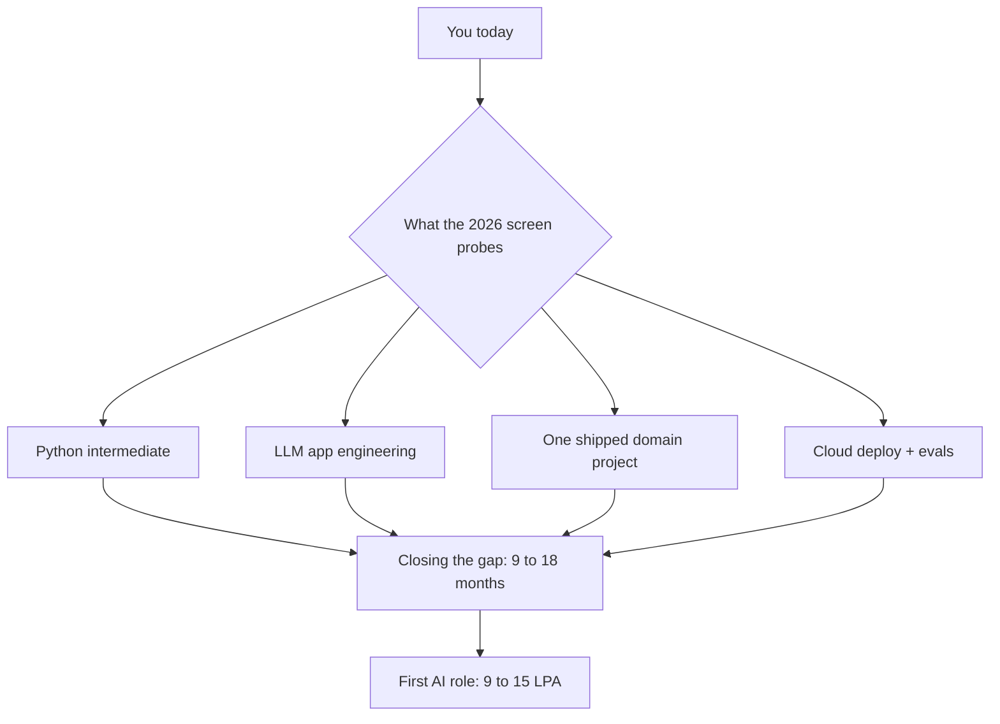

### The numbers you should carry in your head

First AI role in India for your profile: roughly 9 to 15 LPA, often 9 LPA on the TCS internal drive. Within two to three years: 25 to 50 LPA at the mid level. At five years, in the right company: 50 LPA to a crore plus. In the United States, a comparable machine learning engineer runs from $120K to $350K of total compensation, and the top applied roles at the frontier labs go above that. None of this is fantasy. It is the public range. Advertised Indian bands often run 15 to 20 percent above the offer you actually get, so discount when you negotiate.

> **Be honest about the title:**
> AI engineer means different things at different companies. At one firm it is model research. At another it is gluing an API into a workflow. A two-fold pay difference can hide behind the same three words. Always check what the title actually requires before you celebrate a number.

### What this article should leave you with

You are not stuck. You are unpositioned. The difference matters. A stuck person has no move to make. An unpositioned person has many. Over the next eleven articles, we walk through each one, with the salaries, the courses, the legal lines, and the projects. Keep this scorecard in your back pocket. Come back to it in six months. It will tell you whether you have moved.

---

## Article 02: The AI Job Market in India, 2026

*~22 min · Salaries · Hiring · Demand*

Numbers are the only currency that matters when you negotiate. Here is the real 2026 map. Roles, salaries in rupees and dollars, the companies hiring, and the demand signal that tells you where to aim.

### The role map, with 2026 salary bands

India figures are cash compensation in lakhs per annum. The United States figures are total compensation in dollars. Bengaluru carries a 13 to 14 percent premium over the national average. Hyderabad is a few points below. Pune and Chennai run 15 to 25 percent under Bengaluru.

| Role | India (LPA) | US total comp | What it actually is |
|---|---|---|---|
| ML Engineer | 17.5 / 24.6 / 40–55 (jr/mid/sr) | $120K–350K+ | Builds, trains, tunes models. Research-leaning. |
| GenAI / LLM Engineer | 20–35 mid; 38–55 sr; up to 50–70 at top startups | $200K–350K+ | Fastest growing, highest paying. RAG, agents, fine-tuning. |
| MLOps Engineer | 25–35 mid; 38–50 sr | $180K–300K+ | Serves and monitors models in production. DevOps overlap. |
| Data Scientist | 12–15 / 20–30 / 50–65 | $110K–280K+ | Widest band. Title inflation is real. |
| AI Product Manager | 15–45 | $150K–250K | Non-coding. Experienced PMs move in. |
| Applied AI Engineer (frontier lab) | 35–55L jr; 55–90L mid; 90L–1.5Cr+ sr (global-remote India) | $211K median (Palantir FDSE); $350–550K mid-sr | Equity is 60–70% of comp. The 2026 standout channel. |
| AI Support / Implementation Specialist | 8–18 (estimate) | n/a | Natural first stop from a support role. |

> **The band you are aiming at:**
> For your profile, the realistic first landing is the 9 to 15 LPA band. That is the TCS internal drive floor and the junior external range. Do not plan your life around the 70 LPA number. Plan it around the 9 to 15 LPA floor and the 25 to 50 LPA second step.

### Who is hiring, and how they hire

Three tiers. The big IT services firms are hiring into AI-specific pods. TCS runs a 2026 skill-based drive for 2 to 4 years of experience at 9 LPA and up, with a 50 thousand joining bonus. It is cutting bench and delivery roles while it grows AI teams. Infosys, Wipro, HCL, and Tech Mahindra are doing the same dance.

Then the product and startup tier. Sarvam AI, Krutrim, and Gnani. India's AI startups raised $1.07B in the first half of 2026, up 33% from the year before. These firms hire aggressively and pay in equity.

Finally, the global-remote frontier labs. OpenAI, Anthropic, and Palantir hire applied engineers in India, paying in rupee-denominated bands that still beat most domestic product roles. Palantir's forward-deployed engineer role sits at a $211K median in the US. The India remote version is a fraction of that, but it is the strongest India-based remote channel in 2026.

> **How they screen has changed:**
> In 2026, hiring is portfolio-first. A GitHub with shipped projects, a Kaggle ranking, and a deployed system outrank a wall of certificates. A certificate tells them you watched a course. A repo tells you you built a thing. Build the thing.

### The demand signal, in one picture

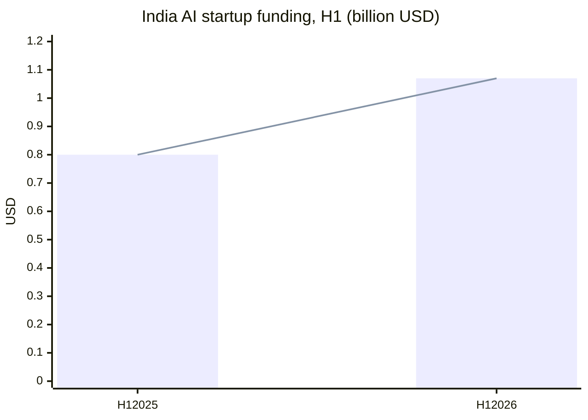

Funding up 33 percent year on year means the hiring engine is turning faster, not slower. The 82% talent-shortage figure is the other half of the same story. Money is in, and it is looking for people who ship.

### What to do with this map

Print this table. Put it on your wall. In Article 11 we pick the exact lanes that fit a TCS engineer who is not ready to quit. In Article 5 we lay out the study plan that gets you into the 9 to 15 band, then the 25 to 50 band. Right now, just hold the shape of the market in your head. The details come next.

---

## Article 03: Five Paths, Ranked by Risk

*~20 min · Career lanes · Timelines*

You have five realistic lanes out of a TCS SAP CPQ support seat. They differ in how fast you can start, how risky they are, and where they end. Pick one primary lane. Run a secondary one in parallel. Do not run all five at once. That is how you finish with five half projects and no job.

### How to read the ranking

Lowest risk means you keep your salary while you move. Highest upside means the ceiling is higher, but you give up more stability. The ranking is from the seat you are sitting in, not from an abstract perfect world.

| Path | Time to first move | Risk | Upside | Best if |
|---|---|---|---|---|
| 1. Internal TCS AI pod | 3–6 months | Lowest | ₹9–15 LPA | You want zero income risk |
| 2. MLOps / AI infra | 6–12 months | Low | ₹25–50 LPA | You like Linux and clouds |
| 3. GenAI / LLM engineer | 9–18 months | Medium | ₹20–70 LPA | You want the highest ceiling |
| 4. Global-remote applied AI | 12–24 months | Medium-high | ₹35–1.5Cr+ INR | You can build strong evidence |
| 5. Freelance / consulting | Parallel, 2–3 case studies | Higher | $100–250/hr | You have 2–3 shipped projects |

### Path 1: The internal TCS AI pod (lowest risk)

This is the move that costs you nothing to start. TCS has a 2026 skill-based AI hiring drive. Two to four years of experience, 9 LPA and up, a 50 thousand joining bonus. You do not quit. You do not lose benefits. You re-skill on the clock, in a system that pays you while you learn. The catch is that the drive is competitive and the pods are real, not decorative. Article 11 goes deep on this lane. Do it first, even if you plan to leave later. It lowers every other path.

### Path 2: MLOps and AI infrastructure (the quiet winner)

You are already touching servers, logs, and integrations in support. MLOps is the direct continuation of that. Containerize a model. Deploy it on a cloud. Watch it in production. Learn about drift, latency, and cost. This is under-reported in salary databases, but the market signal is clear. Engineers who can build model-serving infrastructure and automated retraining pipelines are in short supply everywhere. Highest starting salary of the engineering paths because of the DevOps overlap.

### Path 3: GenAI and LLM engineering (the ceiling)

The fastest-growing and highest-paying role in 2026. RAG systems, agent architectures, fine-tuning. This is where your CPQ domain becomes a weapon. Nobody building a generic LLM app understands quote-to-cash. You do. The cost is that it is the longest lane. Nine to eighteen months of part-time study, and you still need a shipped project to prove it. Article 5 is the month-by-month plan for exactly this path.

### Path 4: Global-remote applied AI (the bypass)

The frontier labs hire in India, pay in global bands, and skip the visa question entirely. This is the realistic onsite-equivalent income in one to two years. It bypasses H-1B lottery and the $100K fee discussed in Article 8. The entry bar is high. You need 2 to 3 years of production AI work, or a flagship project strong enough to stand in for it. This is not your first move. It is your second or third.

### Path 5: Freelance and consulting (the side engine)

You do not leave your day job for this one. You run it alongside, once you have two to three case studies. Prompt engineering runs $75 to $100/hr at entry. Senior AI implementation runs $150 to $250/hr. India-sourced work has a floor of about $3,500 per project. You price by value, not by hours, once you can document a client's ROI. Article 9 covers the legal and tax setup so this income is clean.

### How the five paths connect

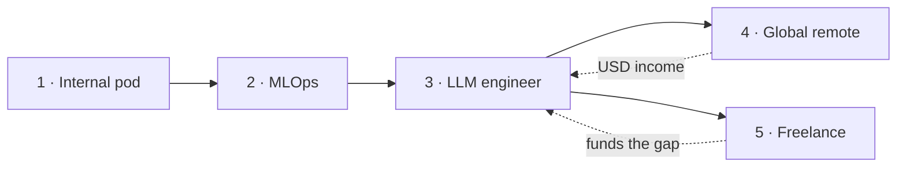

Read the diagram left to right. The internal pod funds and de-risks everything after it. Freelance and global-remote are exit ramps that unlock later, not starting gates. You do not have to do all five. You pick the one that matches how much risk your life can carry this year.

### The decision you make today

Circle one number in the table above. That is your lane. The next four articles are the detailed playbooks for the lanes most TCS support engineers actually pick. One more sentence to close this one. The single biggest career mistake is to run five lanes at once and finish none. One lane. One shipped project. One interview loop. That is the whole game.

---

## Article 04: SAP CPQ in the AI Era

*~20 min · SAP · Joule · CPQ market*

Is SAP CPQ dying? No. Is it being reshaped by AI? Completely. And the reshaping is exactly what makes your knowledge valuable instead of obsolete. Here is what is actually changing, with the specific product names and release notes to back it up.

### The one thing to memorize: AI sits in front of the rules engine

This is the structural insight that every CPQ practitioner is converging on. AI handles the conversational layer. It takes a natural-language need and drafts a configuration. It guides pricing. It assembles documents. But the deterministic constraint solver, the part that guarantees a configuration is actually buildable, does not get replaced. It stays rule-based. And that is precisely where CPQ domain knowledge stays valuable.

In one line. AI sells and drafts. The rules engine guarantees. You know the guarantees. That is your moat.

### What SAP itself is doing

At TechEd in November 2025, SAP committed to 400 Business AI use cases by the end of the year, including 40 Joule Agents built on 2,100 Joule Skills. Three hundred of those use cases are already benchmarked at a value-add of €441M for a company with €10B in revenue. At Sapphire 2026, SAP is touting a reimagined Joule experience and a new SAP Business Suite that unifies AI, data, and apps.

For CPQ users, the relevant piece is the Quoting Assistant. It is a Joule use case that automates quote creation, product configuration, upsell recommendations, and document assembly. It is grounded in the SAP Knowledge Graph, so it understands products, price conditions, account hierarchies, and quote lifecycle objects. Not just text. That is why it is more powerful than a generic chatbot pointed at your data.

### The detail that tells you where the market is going

In CPQ release 2608, SAP obsoleted the older CPQ-to-CX AI integration. That was the first-generation, bolt-on AI path that did cross-sell and discount recommendations through ingestion and inference mapping. It is gone, consolidated into the Joule and platform AI stack. Read that twice. The first-gen CPQ-native AI is being absorbed into a platform question.

> **What this means for a support engineer:**
> Administrators are told to audit whether their tenants still depend on the old CX AI recommendation behavior. That audit is day-one support work and it is a differentiator in any AI-era interview. If you can walk into a role and say "I know which AI features are live in this tenant version and which ones were deprecated in 2608," you are ahead of every pure-CS candidate who has never touched an ERP.

### The competitive field is moving too

| Vendor | The AI move | Status |
|---|---|---|
| Salesforce | Moved from classic CPQ to Agentforce Revenue Management | Legacy CPQ frozen for new features |
| Oracle CPQ | Configuration AI-Assist Agent in release 26C | Gartner Leader, 9th year |
| Tacton | AI Product Modeling Assistant | Shipped May 2026 |
| Conga | Acquired PROS B2B, a pricing-intelligence business | Closed Feb 2026 |
| ServiceNow | Entered the CPQ market via the Logik.ai acquisition | Closed Q2 2025 |

The market is growing, not shrinking. One estimate puts CPQ at about $4B in 2026, rising toward $10B by 2033. The most durable trend is AI for the people who build and maintain configuration models, not just the buyers. That is the modeler lane, and it is an engineering lane.

### How AI is reshaping the support role itself

SAP runs agentic AI in its own customer support. The Auto Response Agent resolves known issues at an 80% confidence threshold. The pattern is instant resolution first, then humans for the exceptions. That is the template for any L1 and L2 CPQ support desk, including the one TCS delivers. The most exposed work is ticket triage and known-issue handling. The least exposed is integration debugging, Quote 2.0 migration issues, and admin governance. Know which side of that line your daily work sits on. If you are mostly on the exposed side, you have more reason to move, not less.

### What to learn on the SAP side specifically

SAP's developer catalog has free, dedicated tracks. Around 192 AI tutorials, 284 machine learning tutorials, 8 Joule tutorials, 57 on AI Core, and over 1,300 on the Business Technology Platform. The natural, employer-relevant learning lane is right there, free, and it is the depth leg of the T-shape in Article 12. The key credential to plan for is the SAP Certified Associate for Generative AI Developer, code C_AIG, which covers the BTP, the AI Core, and the Generative AI Hub. In 2026, SAP is also shifting its exams from multiple choice to practical, open-book performance tests. The credential now tests what you can do in a real system, not what you memorized.

### The takeaway

CPQ is evolving, not dying. The product keeps shipping, with Quote 2.0 as the direction of travel and new S/4HANA integration flows in 2608 and 2609. The low-end niche is narrowing. Simple shops can use Sales Cloud quoting with Advanced Variant Configuration instead. But the complex, high-stakes, audit-sensitive configurations, which is where you are, are where AI and CPQ intersect and where a domain expert becomes the most expensive person in the room. Your job is to be the bridge, not the casualty.

---

## Article 05: The 14 to 18 Month Learning Roadmap

*~24 min · Courses · Certs · Timeline*

This is the machine. It assumes you work 9.5 hours a day at TCS and can carve out 8 to 10 hours a week for learning. Two evenings of two hours, one weekend block of four hours. That is about 40 hours a month, which is one portfolio-quality project every three months. The entire hard cost of this plan is about $150 to $260. Everything else is free.

### The skill you actually need, and the skill you do not

You do not need to know everything about AI. The 2026 applied market rewards a narrow, verifiable stack. Solid intermediate Python, then classical machine learning intuition, then large language model application engineering, then one cloud deployment, then one deep domain project. The stack in order, not the textbook in order.

> **Skip, with confidence:**
> Deep linear algebra proofs, classical computer vision research, robotics, and reinforcement learning theory. A light pass is fine. These do not show up in the applied interview loops we are targeting. Your hours are better spent shipping one RAG system than proving a gradient identity.

### The month-by-month plan

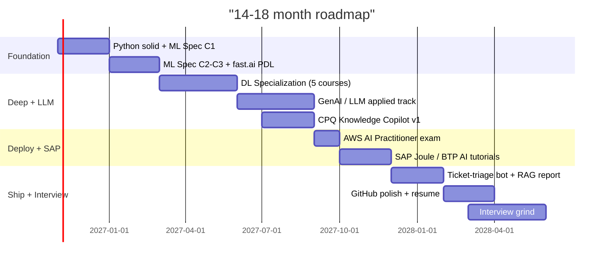

### The courses, with names and costs

| Course | Platform | Cost | Duration | Why |
|---|---|---|---|---|
| AI for Everyone | Coursera · Andrew Ng | free audit | 7 hours | Orientation. Do it once. |
| Machine Learning Specialization | Coursera · Ng + team | free audit, ~$49–79 cert | ~2 months @ 10 hr/wk | The ML core. 852k enrolled, 4.9/5. |
| Deep Learning Specialization | Coursera · Ng + team | free audit, ~$49–79 cert | ~3 months @ 10 hr/wk | Includes transformers, HuggingFace, NLP. Not legacy. |
| Practical Deep Learning for Coders | fast.ai · Jeremy Howard | free | ~5 weeks | Hands-on counterweight to the Coursera theory. |
| Generative AI with LLMs | Coursera · HSE University | free audit | ~10–12 weeks | The LLM theory leg. |
| LangChain / RAG / Agents short courses | DeepLearning.AI | free | 3–8 hrs each | The applied LLM leg. |
| AWS Certified AI Practitioner | AWS | $100 exam | 3–4 weeks prep | Cheapest verified cloud AI credential. |
| SAP BTP / Joule / AI Core tutorials | developers.sap.com | free | 1–2 months | Your domain depth leg. |

> **The cheapest entry credential:**
> The AWS Certified AI Practitioner is $100, 90 minutes, 65 questions, valid for three years. It is the single cheapest way to put a cloud AI credential on your resume. AWS's own recommended next step is the ML Engineer–Associate, but you do not need that one to get hired. One cloud credential plus a shipped project is the 2026 bar.

### What you should know at each gate

Gate one, after two months. You write Python without a tutorial open. You understand a training split, bias-variance, and when a model overfits. Gate two, after five months. You can explain why attention replaced RNNs, what an embedding is, and the difference between a generative and a discriminative model. Gate three, after ten months. You have a RAG pipeline you built, you have evaluated it on a golden set of about 50 questions, and you can explain why you chose your chunk size. Gate four, after fourteen months. Your three projects are on GitHub with clean READMEs, and your resume has been rewritten in the new vocabulary.

### The habit that halves the project cost

Build the portfolio from your own work artifacts. Every ticket pattern you see at TCS becomes a dataset sketch. Every customer question you answer becomes an evaluation pair. Keep a golden-qa file open on your machine. Add one real CPQ question and your answer to it, every week. In twelve months, you have a private evaluation set that no course gives you. That is the single highest-leverage habit in this entire book.

### The math of the money

The total hard cost is roughly $100 for the AWS exam, plus $50 to $160 if you pay for one Coursera certificate and one more exam. That is the $150 to $260 range. Course audits are free. fast.ai is free. The SAP tutorials are free. The Kaggle micro-courses are free. You are not paying for knowledge in this plan. You are paying for a credential and a small margin of convenience. If money is tight, skip the paid certificate. The GitHub ships the message, not the badge.

---

## Article 06: Three Portfolio Projects That Get You Hired

*~22 min · Projects · GitHub · Evidence*

In 2026, the thing that separates you from the crowd is not a certificate. It is a system you shipped that you can defend decision by decision. Three projects, in a ladder, each one building on the last. The first is your flagship. The second maps to the interview. The third proves you know the decision framework. Total build time: about six to nine months, spread across the roadmap in Article 5.

### Project one: The CPQ Knowledge Copilot (your flagship)

This is the project a non-SAP candidate cannot credibly claim. You build a retrieval-augmented generation system over SAP CPQ and S/4HANA documentation, plus a synthesized set of demo data. Quote objects, discount rules, approval workflows. A user asks, "Why did this quote fail approval?" or "What is the discount rule for this product family?" The system retrieves the relevant document chunk, re-ranks it, assembles a prompt, and returns a grounded answer with a citation.

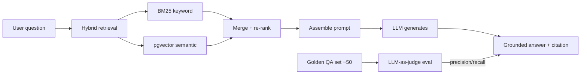

The technical depth is where the signal is. Choose a chunk size and explain why. Use hybrid retrieval, not pure vector, and explain when hybrid beats vector. Build a golden set of about 50 question-answer pairs from your real support experience. Run an LLM-as-judge evaluation and report the metrics. Containerize the whole thing with Docker. Deploy it on a free cloud tier. Write a README that documents your latency and cost budget. That README is the thing an interviewer reads first.

> **Why this project wins:**
> It is a domain moat. A generic LLM app proves you watched a course. A CPQ-aware RAG system with an eval harness and a citation trail proves you can take AI into a structured, process-bound, audited enterprise environment. That is exactly the job.

### Project two: The Support-Ticket Triage and Deflection Agent

This is your literal current domain, turned into a portfolio piece. You build a system that classifies incoming support tickets by intent, routes them by severity, and drafts responses with citations. For simple, safe fixes it runs an agent loop with clear stopping conditions. You build a golden set from anonymized ticket categories and report precision and recall per class.

Here is the part that makes this project worth its weight. This project is a mock of the system-design interview round. When an interviewer says "design a support assistant," you do not describe a hypothetical. You point to the repo. You explain why you chose this routing, where it fails, what your stopping conditions are, and what you would change if retrieval returned the wrong context. You practice the exact interview scenario inside your own portfolio. That is a rare advantage. Most candidates describe. You demonstrate.

### Project three: The RAG-versus-Fine-tune Benchmark Report

Pick one dataset. Build two pipelines. One uses retrieval-augmented generation. One fine-tunes a model. Measure cost, latency, and answer quality on the same evaluation set. Publish the write-up and the code. This proves you know the 2026 decision framework, which interviewers explicitly probe. When to use RAG. When to fine-tune. When to do neither and just prompt. And it proves you can run an evaluation harness, which is the skill that separates the people who shipped from the people who prototyped.

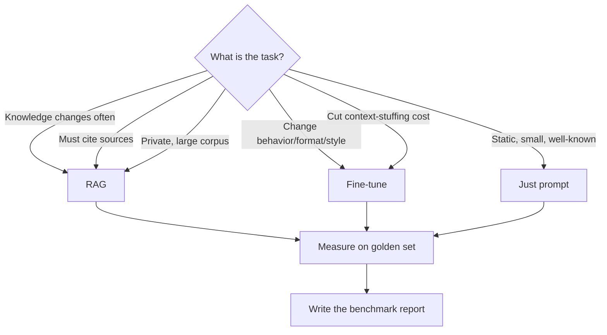

### The GitHub hygiene that matters

One repository per project. Each has a top-level README that tells the whole story. The problem. An architecture diagram. The key decisions with their trade-offs. The evaluation results in a table. And a short section titled "What I would change next." A single portfolio index links all three. Recent commit cadence matters more than star count. It shows you are still practicing, not that you did one push two years ago.

| Repo | Content | Signal it sends |
|---|---|---|
| cpq-knowledge-copilot | Flagship RAG system + evals | Domain moat + shipping discipline |
| ticket-triage-agent | Mock of the system-design round | You can do the interview's exact scenario |
| rag-vs-finetune-bench | Benchmark write-up | You know the decision framework |
| ml-portfolio | Course artifacts, brief | Breadth, without noise |
| mlops-lab | Docker + K8s serving experiment | You can deploy |

### What to avoid

Fifty half-finished notebooks with no README. Course code copied with no analysis of your own. No evaluation artifacts. These all send the same message. You did not finish things. In 2026, an unfinished repo is worse than no repo, because it tells the reader you cannot ship. Three finished projects beat thirty started ones, every time.

### The one-sentence close

Certificates say you learned. Repos say you built. The 2026 screen reads repos. Make the three in this article the center of everything you do for the next six to nine months, and the interviews in Article 10 become a demonstration instead of a test.

---

## Article 07: The Legal Playbook

*~22 min · Employment · Tax · IP · AI law*

This is the article that keeps you out of trouble while you move. It covers your TCS exit, the tax setup for freelance income, intellectual property, and the legal status of AI-generated work in India. This is a map, not legal advice. Before you act on anything here, talk to a qualified Indian advocate or chartered accountant.

### Your TCS exit, the part that surprises people

Post-employment non-compete clauses are void under Section 27 of the Indian Contract Act, 1872. The Supreme Court settled this in 1980. You can join a competitor the day after your notice ends. What is enforceable is the 90-day notice period in your contract, and the confidentiality clauses. TCS can deduct unserved-notice salary from your full and final settlement. It cannot physically stop you. A breach of notice is a civil matter, not a criminal one.

> **The highest-risk act before you leave:**
> Copying code, client data, or internal TCS material to a personal device. That is the one act that crosses from civil breach into potential criminal territory under the IT Act. Before you resign, do not copy anything. Keep your personal AI project completely separate from TCS work. Track and document that separation.

### The tax reclassification you must plan for

The moment you start freelancing, your income stops being salary. It becomes business or profession income under Section 28 of the Income-tax Act. You now file ITR-3 or ITR-4, you self-compute and pay advance tax in four instalments, and GST registration kicks in at ₹20L of turnover. Exports of services to foreign clients are zero-rated, but you file a Letter of Undertaking to avoid paying 18% IGST upfront.

> **The change most online guides still miss:**
> The Income-tax Act 2025, effective 1 April 2026, repealed the old 44AD, 44ADA, and 44AE sections. They are consolidated into Section 58. Most CA guides you find online still cite the 1961 Act numbers, which are now repealed for the 2026-27 tax year. The substance is carried forward, but the section numbers are different. If you use the presumptive taxation route, you must cite Section 58, not 44AD. This is the kind of detail that separates a CA who is current from one who is not. Verify with your accountant before you file.

### What belongs to TCS, and what belongs to you

All work product created in the course of your employment belongs to TCS. Copyright Act Section 17 makes the employer the first owner of copyright in work made during employment. The Patents Act Section 6(2) makes service inventions, made in the course of employment, belong to the employer. What you keep is your general skills, your knowledge, your experience. Those are yours. The confidential information, the client relationships, the code, the internal processes. Those are TCS's, even after you leave.

### The legal status of AI-generated content in India, 2026

There is no standalone AI law in India yet. The current binding framework is the Digital Personal Data Protection Act of 2023, the IT Act of 2000, the Copyright Act of 1957, and the MeitY AI Governance Guidelines released in November 2025. Those guidelines are principle-based, not a law. They set de-facto compliance expectations for government and enterprise procurement.

On copyright, the position is clear. Fully autonomous AI output is not copyrightable in India. The Copyright Act requires a human author. The Copyright Office rejected the DABUS patent case in 2026 on the same grounds. Human-assisted AI work, where you exercise real creative control, judgment, and selection, is protectable. The grey zone is everything in between. If you prompt an AI, select from its outputs, and arrange them into something new, you are likely the author. If you just press generate and take whatever comes out, you are not.

### The AI regulation landscape, what is real and what is not

| Instrument | Status | What it does |
|---|---|---|
| Digital Personal Data Protection Act 2023 | Enacted. Rules notified Nov 2025. Full enforcement ~May 2027. | Penalties up to ₹250Cr per breach for AI that processes personal data. |
| MeitY AI Governance Guidelines (Nov 2025) | Released. Principle-based. Not a law. | 7 "sutras." Sets de-facto procurement standards. |
| AI Ethics and Accountability Bill 2025 | Private Member Bill. Not enacted. | Proposes high-risk registration, impact assessments, ₹5Cr penalties. |
| EU AI Act | In force since Aug 2024. High-risk obligations begin 2026. | Extraterritorial. Indian AI companies serving EU clients must assess it. |
| IndiaAI Mission | Active. | 38,000+ GPUs, 9,500+ datasets, 273 sectoral models. |

### The practical checklist before you move

1. Read your specific TCS employment and offer letter. The notice period, the buyout clause, and the exclusivity language are contract-specific, not statute-specific.
2. Do not copy code, data, or IP to personal devices before or after leaving.
3. Engage a CA to model salaried versus freelance effective tax. Ask specifically about Section 58 presumptive versus normal ITR-3 computation. Ask about GST registration and the LUT for exports.
4. If you are US-bound, the H-1B landscape has changed. Article 8 covers the specific options.
5. Comply with the DPDP Act and the MeitY guidelines now. They are the de-facto procurement standard. Document your human inventive contribution to preserve patentability on anything you build.

### The close

None of this is a reason to be afraid. It is a reason to be careful. The legal system in India does not stand in the way of your career move. What does stand in the way is a sloppily handled transition. Keep the work separate, keep the tax clean, and keep the IP yours. Do those three things and the law is on your side.

---

## Article 08: Visas, Remote Work, and the Grey Areas

*~20 min · Visas · Remote · FEMA · DTAA*

This is where a lot of Indian IT professionals get burned. Not by the law itself, but by acting on outdated assumptions about it. The H-1B is not what it was in 2019. Working for a foreign company from India has specific FEMA rules. And the moonlighting question that nobody in your office will answer for you is actually a contract question, not a statute question.

### The H-1B, and the fee that changes the math

As of 21 September 2025, the H-1B visa carries a new $100,000 fee, imposed by a Presidential Proclamation. It is roughly 60 times the prior fee. It is legally contested, with challenges and changes to the lottery rules in September 2025, but it is currently in force. The Indian government flagged the humanitarian consequences. The practical effect is that the H-1B is no longer the default path it was. You can still try, but you should not build a 2026 career plan on winning a lottery that now costs $100K to enter.

> **The two realistic alternatives:**
> The L-1 visa is an intra-company transfer. No cap, no lottery, roughly a $7,000 cost. It requires one year at a foreign affiliate in the last three years and is employer-specific. For TCS staff moving to a US affiliate, this is the strongest realistic route. The O-1 visa is for extraordinary ability, no cap, roughly $12,000, and about a 93% approval rate. It is evidence-based, with publications, presentations, and awards. It is also a stepping stone to the EB-1A green card.

| Visa | Cost | Cap? | Best for |
|---|---|---|---|
| H-1B | $100,000 new fee | Yes, lottery, ~73% rejection | Contingent, not a plan |
| L-1 | ~$7,000 | No cap | TCS staff → US affiliate |
| O-1 | ~$12,000 | No cap, ~93% approval | Strong public record |
| EB-5 | Investment in USD | Green card path | Capital available |
| OPT | n/a | Students only | F-1 status |

### Working for a foreign company from India, the clean version

It is legal. You do not need an India-side work permit if you are a resident employee. Your income is global income, taxed in India under Section 5 of the Income-tax Act. But the money has to come in through approved dealer bank channels. SWIFT, PayPal, Payoneer, or Wise. You get a FIRC from the bank or a FIRA from the gateway. You repatriate the funds within nine months of service completion or invoice. Use the correct purpose codes, P0802 for software consultancy, P0806 for IT services. Do not let money sit indefinitely in a foreign wallet.

If you are a contractor or freelancer, not an employee, the income is business income and the FEMA repatriation and GST LUT rules from Article 7 apply. If you are an employee of a foreign company, the grey area is on their side. They may owe India-side employment tax or social security exposure. That is often a decision between them and an employer-of-record provider. It is not your problem to solve, but you should understand it exists.

### The moonlighting question, answered

Moonlighting and dual employment are not statutorily banned for private-sector workers. The Factories Act bars dual employment for factory workers, which does not describe an IT office role. For you, it is a contract issue. Your TCS agreement's exclusivity clause, conflict-of-interest language, and confidentiality terms are what govern you. During employment, those are enforceable. The moment you misuse TCS tools, TCS code, or TCS working hours for side work, it becomes a material breach, with potential civil and criminal exposure under the IT Act and IP misappropriation.

> **The clean way to moonlight:**
> Use your own equipment. Work off TCS hours. Do not use TCS confidential information. Do not work with TCS clients or TCS competitors in conflict. Disclose it if your contract requires disclosure. Document the separation. If you can explain your side work to a lawyer and they nod, you are fine. If they wince, stop that specific activity.

### Double taxation, and the tool that fixes it

If you earn income abroad and pay tax there, you are not taxed twice. India has Double Tax Avoidance Agreements with most countries, and Section 90 of the Income-tax Act lets you claim relief for tax paid abroad. You still declare the global income, but you get a credit or exemption for the foreign tax. The mechanism depends on the specific DTAA. This is another reason to have a CA who handles cross-border income, not one who only files salaried returns.

### The EU options, briefly

The EU Blue Card is a real path for 25 of the 27 member states, excluding Denmark and Ireland. It needs a higher education degree, three years of experience or a shortage occupation, and a qualifying salary. Germany's threshold is roughly €58K for general roles and €44K for shortage occupations. A German remote-work visa is forthcoming and in an interim stage as of 2026, with a threshold around €1,200 a month. It is not fully live. Do not build a 2026 plan on it. Use the Section 21 freelance visa or the Blue Card instead.

### The digital nomad visas

If you are relocating abroad while keeping Indian or foreign clients, digital nomad visas in Portugal, Spain, Estonia, Croatia, and Serbia are open to Indian remote workers. India does not offer a digital nomad visa to foreign remote workers, which is not relevant to you, since you are the one relocating. The DNV matters only if you move to a host country and keep working remotely from there.

### The decision tree

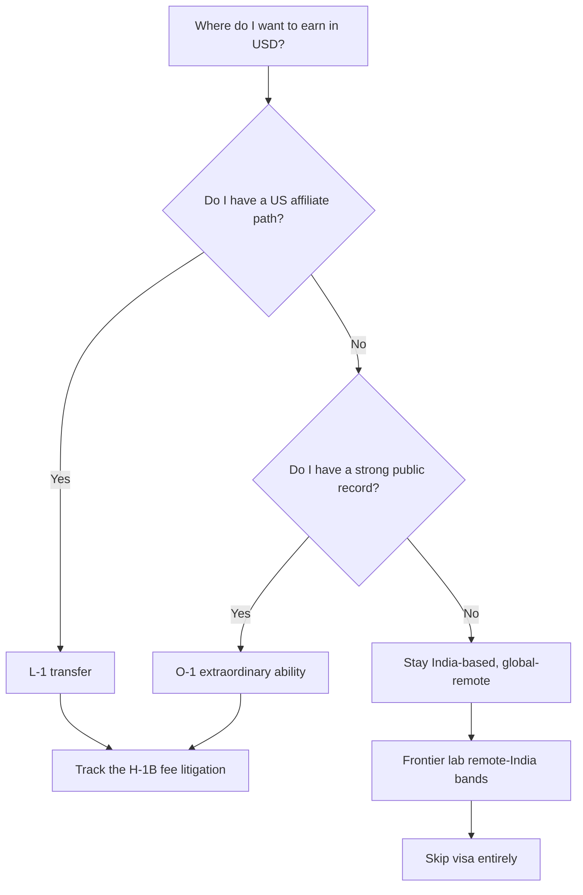

### The close

The visa and remote-work rules are not walls. They are rules of the game. The $100K H-1B fee pushed the smart move away from lottery dependence and toward L-1, O-1, and global-remote work from India. Those three are the realistic lanes in 2026. Pick the one that matches your record, and keep the H-1B as a wildcard you are not depending on. And whatever you do, get the money in through the right bank channels, with the right codes, inside nine months. That is the detail that keeps a clean income from becoming a FEMA problem.

---

## Article 09: Freelancing in AI: Earning $100 to $250 an Hour from India

*~18 min · Freelance rates · Pricing · Setup*

Freelance AI work is the fastest way to raise your income without leaving your day job. The rates are genuinely high because the skills are scarce and the work is delivered entirely across the internet. The catch is that you are not hired at those rates from day one. You earn them by building case studies, not by posting a profile. Here is the full picture, from entry rates to value-based pricing to the legal setup that keeps the income clean.

### The rate map, by level

| Work | Entry | Mid | Senior / specialist |
|---|---|---|---|
| Prompt engineering | $75–100/hr | $100–150/hr | $150–250/hr |
| AI implementation / consulting | $100/hr | $150–195/hr | $200–275/hr |
| AI automation consultant | $80/hr | $120–175/hr | $175–225/hr |

Senior AI consulting runs 130 to 220 percent above traditional tech freelance rates. That premium exists because AI work is new, risky for the client, and hard to verify. The client pays for someone who has shipped it before and can be held accountable. That is the position you are moving into, and it is why the ceiling is so high.

### Project sizes and India's entry floor

Startup AI projects run $5K to $25K. Enterprise projects run $15K to $60K. For India-sourced work, the project floor is around $3,500, which works out to roughly $60 to $110 an hour in equivalent value. North American projects start at $10K and above, equivalent to $175 to $250 an hour. The gap between those two numbers is where your domain expertise lives. A generic prompt engineer does the floor. A person who understands ERP, CPQ, and supply chain support automation does the North American band.

> **Your pricing model, in three stages:**
> Stage one is hourly, while you are proving yourself. Stage two is project-based, $5K to $80K, once you understand the shape of the work. Stage three is value-based, 10 to 15 percent of the documented client ROI. A retainer of $3K to $15K a month for AI advisory is the stable middle. Move up the ladder as your case studies accumulate. Do not jump straight to value-based pricing. You need the ROI documentation first.

### Realistic monthly income, stated plainly

Once you have two or three case studies, 10 to 20 hours a week of consulting earns roughly ₹150K to ₹400K a month in India. The top freelancers doing specialist work clear $150 to $250 an hour. Those are not fantasy numbers. They are the public bands for the work. The difference between you and them is shipped evidence, not talent.

### The niche that fits you, specifically

Do not compete in the generic AI marketplace. You have a domain moat that a bootcamp graduate does not. Your niche is LLM-powered quote and configuration automation for SAP and ERP clients. Pricing anomaly detection. Procurement copilots. Support automation for CPQ and S/4HANA workflows. This is a consultable niche in the $150 to $250 global band, and it is scarce and underserved. A public case study of an LLM-assisted quote or configuration flow is the single asset that opens that niche.

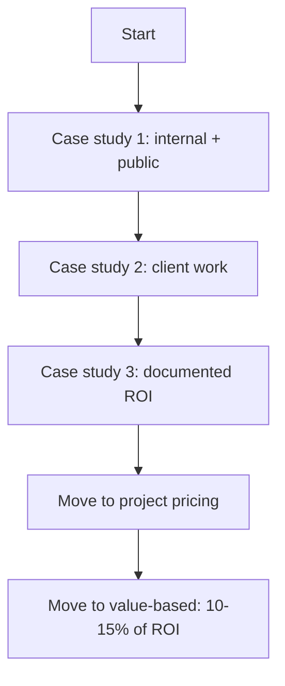

### The setup that keeps it clean

Run the freelance income through the structure in Article 7 and Article 8. Income is business or profession income. File ITR-3 or ITR-4. Pay advance tax. Register for GST at ₹20L of turnover, and file the LUT for zero-rated exports. Receive foreign payments through SWIFT, PayPal, Payoneer, or Wise, with a FIRC or FIRA, and repatriate within nine months. Use purpose code P0802 or P0806. If you stay under the thresholds and use the presumptive route, remember the 2026-27 rules live under Section 58, not the old 44AD.

> **The one rule that protects your day job:**
> Freelance work must be completely separate from TCS. Own equipment, off-hours, no TCS confidential data, no TCS clients, no conflict with TCS competitors. The moment the two overlap, you are not earning freelance income. You are committing a breach of contract with potential criminal exposure. Keep a written log of the separation from day one.

### Where to find the work

The marketplace floor is on the bigger platforms, but the premium work comes through referral and a public portfolio. Your three projects from Article 6, posted on GitHub with clean READMEs and a one-page personal site, are the marketing. Follow the LLM application practitioners on X and LinkedIn. They post the work that pays. The niche SAP and ERP AI consulting is small enough that one strong case study and one visible blog post will get you inbound leads. You are not competing with ten thousand generic prompt engineers. You are the only person in the room who has shipped an ERP-aware LLM system.

### The close

Freelancing is a side engine, not a full-time exit, until you have three case studies and two paying clients. Then it becomes a real income line, and possibly the reason you negotiate your next salary from a position of strength. Start with the internal case study. Make it public. Let the domain moat do the selling. The rates in this article are real, but they are earned by showing the work, not by asking for it.

---

## Article 10: How to Pass the AI Interview in 2026

*~22 min · Interview loop · Answer structure*

The 2026 AI interview is not the data science interview you may have seen in 2023. It has a specific shape, and the round that separates people who shipped from people who prototyped is now the LLM depth round. If you understand the shape and rehearse the answer structure, the interview becomes a demonstration of your portfolio instead of a test of your memory.

### The loop, in order

Recruiter screen. Then coding, which now mixes classic data structures with practical large language model tasks. You call an API, you parse a response, you orchestrate a call, you handle structured output, you debug a failing prompt. Then the machine learning and deep learning fundamentals round. Then the distinguishing round, which is LLM and generative AI depth. Then AI system design. Then a take-home or a project deep-dive. Then behavioral. Two independent 2026 sources agree on this shape. The difference between them is only in how they name the agent-platform specifics.

### The six areas they probe, and what each one needs

| Area | What they probe | Your prep |
|---|---|---|
| LLM basics | Transformers, attention, embeddings, generative vs discriminative | Explain why attention replaced RNNs, in parallelism and quadratic cost |
| Prompt engineering | Zero-shot vs few-shot, structured instructions, versioning prompts | Treat a prompt as a versioned artifact, not a string |
| RAG | Ingestion, chunking, embedding, retrieval, re-ranking, grounded eval | Explain your chunk-size choice and your retrieval metrics |
| Evals | Golden sets, LLM-as-judge and its biases, offline vs production monitoring | Build the golden set, report precision and recall |
| Agents and tool use | Tool schema design, loop mechanics, failure modes, stopping conditions | Explain when a fixed workflow beats an agent |
| AI system design | Defend your choices, cost and latency budget, graceful failure | Your ticket-triage project is the mock of this round |

### The answer structure that scores

For every machine learning concept, use the three-part structure. First, the definition. Second, how you would know it is happening, the symptom. Third, how you fix it, the lever. This structure is explicitly recommended by the 2026 prep sources, and it works because it proves you can reason, not just recite.

Example, bias-variance. Definition. Bias is the error from overly simple assumptions. Variance is the error from overfitting to noise. Symptom. High bias is underfitting, both training and validation loss are high and close. High variance is overfitting, training loss is low and validation loss is high, a wide gap. Fix. For bias, add features, use a more expressive model. For variance, more data, regularization, dropout, early stopping, data augmentation.

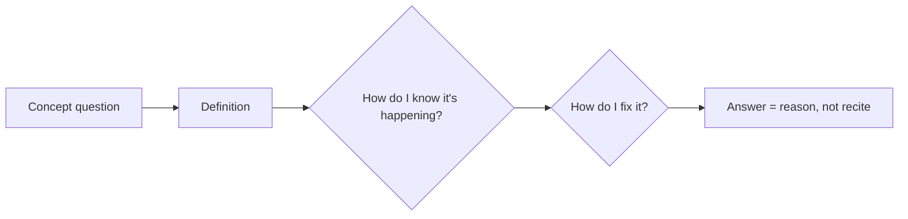

### The RAG-versus-fine-tune decision framework, named in interviews

This is the question that now appears at the LLM depth round. Use RAG when knowledge changes often, when the answer must cite sources, or when the corpus is private and large. Use fine-tuning when you need to change behavior, format, or style, or to cut the cost of stuffing context into every prompt. The two are not mutually exclusive. And sometimes the answer is neither, just prompt. Be able to say out loud which tool you would pick for a specific task, and why. The CPQ Knowledge Copilot project from Article 6 is your worked example of the RAG branch. The RAG-versus-fine-tune benchmark report is your worked example of the whole framework.

### The system-design round, where your domain shines

The question is usually "design a document question-answer system," or "design a support assistant," or "design a research agent." The bar is defending your choices. Chunking and retrieval strategy. An evaluation plan before you trust it in production. A cost and latency budget. Graceful failure. This is where the ticket-triage project pays off. When they ask you to design a support assistant, you do not describe a hypothetical. You point to the repo and explain why you chose that routing, where it fails, what your stopping conditions are, and what you would change if retrieval returned the wrong context. You have already built it. That is the answer.

> **The forward-deployed engineer variant:**
> If the role is a forward-deployed engineer, like the Palantir-originated title that TCS is scaling, the loop adds live problem decomposition, customer scoping, and ownership under ambiguity. It is a behavioral round on top of the technical one. The prep is the same. Explain your decisions out loud, under time pressure, and show that you can scope a messy, under-specified problem.

### The prep method that actually transfers

The best prep is explaining your own project decisions out loud. Why that chunk size. What the evaluation set looked like. What you would change if retrieval returned the wrong context. Do not memorize question banks. Build or revisit one small project for each weak area. Ten system-design reps on the support-assistant scenario, rehearsing your ticket-triage project as the answer, will do more than fifty flashcards.

### The resume and LinkedIn moves that make it land

Rewrite the title line. Move from a support emphasis to "SAP and ERP, plus generative AI engineer, building LLM apps for enterprise ERP domains." Keep SAP as a keyword. Frame the support work in verbs of analysis and automation. Quantify the old job in new vocabulary. "Triage automation of S/4HANA CPQ tickets, saving X hours a week" is a machine-learning-adjacent story. Data curation, latency reduction, error categorization. Order the skills for both the applicant tracking system and the human. LLM application engineering, RAG, Python, Hugging Face, LangChain, OpenAI and Anthropic APIs, Docker, one cloud AI service, machine learning fundamentals, SQL, S/4HANA, SAP BTP, CPQ, ABAP, OData and CDS.

### The close

The 2026 interview rewards the person who can ship and defend a system, not the person who can recite a syllabus. Your three projects from Article 6 are the evidence. Your CPQ domain is the differentiator. The three-part answer structure is the delivery. Rehearse the LLM depth round out loud, twenty times, until explaining your chunk-size choice feels as natural as explaining a CPQ discount rule. Then the interview is not a test. It is a conversation about work you already did.

---

## Article 11: The Lowest-Risk Path, Inside TCS

*~18 min · TCS internal · CoEs · Timing*

Before you spend a rupee on an external job hunt, there is a door that is already open. TCS is actively building AI pods and running a 2026 skill-based hiring drive aimed at exactly your experience band. Moving internally first lowers the risk of every other move in this book. It keeps your salary, keeps your benefits, and gives you a branded stamp on the move. Here is how to use it.

### What TCS is actually doing, with the real numbers

TCS cut roughly 23,000 jobs in fiscal 2026 as it pivoted to an AI-first delivery model. At the same time, it is planning a team of up to 8,900 forward-deployed AI engineers. Those two numbers are not a contradiction. The cuts are in the bench and the traditional delivery roles. The growth is in the AI-specific pods. You are sitting on the seam between the shrinking side and the growing side. The move that makes the most sense is to get onto the growing side before the seam closes.

The 2026 skill-based AI hiring drive targets 2 to 4 years of experience, at a ₹9 LPA floor, with a ₹50,000 joining bonus. You already have the experience band. The drive is the lowest-friction entry point available to you, because you do not leave the company, you do not lose the PF, and you do not face an external interview loop while unemployed.

> **The four Centers of Excellence:**
> In November 2025, TCS signed a five-year deal to transform SAP's own IT landscape with cloud and generative AI. The deal created four Centers of Excellence. Generative AI. Customer Experience. Cloud. And the SAP Business Technology Platform. This matters to you directly. A CPQ support engineer with Customer Experience knowledge is already half-qualified for the Customer Experience Center of Excellence. That is a named internal destination, not a hypothetical.

### Why internal is the de-risking move

An internal move converts a high-risk transition into a low-risk one. You are not negotiating from a position of unemployment. You are not facing a 90-day notice period and a gap in income. You keep your PF accrual, your gratuity clock, and your medical cover while you re-skill. The company is effectively paying you to learn. And when you later move externally, you leave from a higher base, with AI experience on the record, not support experience.

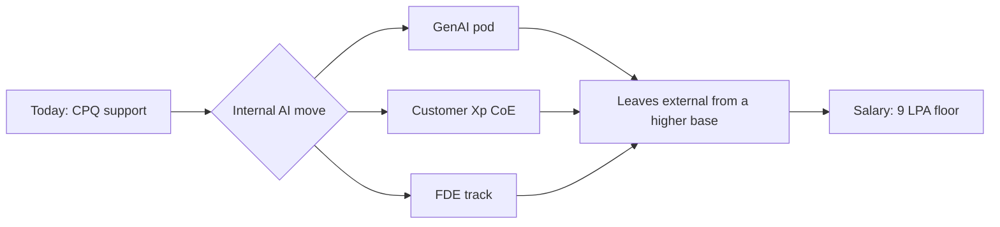

### The honest limits of the internal path

Being inside TCS does not guarantee the move. The drive is competitive. The pods are real, but they are not decorative, and the slots are finite. You still need the skills from Article 5 and the evidence from Article 6 to clear the internal bar. The internal path lowers the floor, it does not remove the work. If you move internally and the pod is weak, you have still moved, and you have the branded record. That is better than staying in a shrinking support bench.

> **The timing rule:**
> Apply to the internal drive in the first two months of your study plan, not in the eighteenth. The reason is that internal transfers reward demonstrated interest and you want to be inside the system when the slots open. But do not apply before you have the CPQ Knowledge Copilot v1, because the application asks for shipped evidence. The sequencing is build the first project, then apply, then use the internal loop as a rehearsal for the external one.

### What to say in the internal case

Your pitch is the T-shape from Article 12. I have 5 years in SAP ERP support. I know CPQ quote objects, discount logic, and S/4HANA integration at a depth most AI engineers have never seen. And I have started building LLM systems for that domain. The CPQ Knowledge Copilot is my evidence. The question is not whether I can do AI. The question is whether I can take AI into the environment where the data is structured, process-bound, and audited. That is the answer a pure computer-science candidate cannot give, because they have not been in the environment.

### The parallel track, so you are not boxed in

Run the internal move and the external search at the same time, once you reach month 12. The internal loop is the rehearsal. The external applications to Bengaluru and Hyderabad product and GCC roles, at a 15 to 35 LPA target, are the real prize. Having an internal offer or a strong internal interview on the record changes your external negotiation. You are not desperate. You have a path. That changes the tone of every conversation.

### The decision gate

At month 12, make one clean decision. If a TCS internal AI or generative AI practice has an opening, apply internally first. Domain fit, employer brand, and the internal transfer discount all point the same way. In parallel, target two external SAP-adjacent generative AI roles per week. The internal move is not the destination for most people in your seat. It is the bridge that gets you across with less risk. Use it as the bridge, not the house.

### The close

The single most under-used asset in your position is the company you already work for. It is cutting the old roles and building the new ones, and it is paying you to move between them. Read your internal drive eligibility. Build the first project. Apply. Do this before you spend a rupee on an external career coach. The lowest-risk move is the one that happens while your paycheck is still coming in.

---

## Article 12: The T-Shaped Strategy — AI Breadth, SAP Depth

*~16 min · Positioning · Moat · Closing*

This is the last article, and it is the one that ties the other eleven together. The T-shape is not a metaphor you read about. It is a positioning strategy you execute. The horizontal bar makes you employable in any AI team. The vertical bar makes you rare. And the way you phrase the two together is the line that gets you hired in a market where ten thousand bootcamp graduates are applying for the same entry role.

### The two legs, precisely

The horizontal bar is the AI breadth. Intermediate Python. Machine learning fundamentals. LLM application engineering, which is retrieval-augmented generation, agents, and evaluation. One cloud AI certification. Docker. This bar makes you employable. It is the entry ticket. Almost every candidate you compete with will have at least part of this bar, because it is the standard curriculum.

The vertical bar is the depth. CPQ and S/4HANA domain knowledge. SAP Business Technology Platform AI. Joule. This bar makes you rare. It is the moat. A pure computer-science candidate can learn the horizontal bar in a few months. They cannot learn the vertical bar, because it takes the years you already spent. That asymmetry is the entire value of your position.

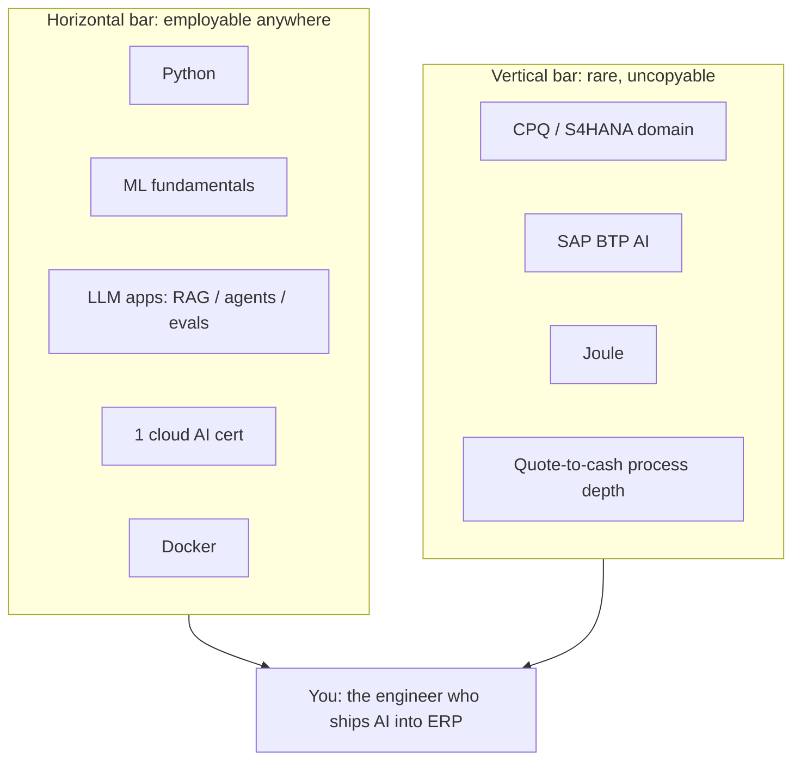

### The positioning line

Write this down. It is the sentence that goes on your resume, your LinkedIn, and your cover note.

> **The line:**
> I am an AI and ML engineer with 5 years in SAP ERP support on S/4HANA and CPQ. I build and evaluate LLM systems for enterprise data and process domains. The domain is the moat. The AI stack is the entry ticket.

Read that again. It does not say "support engineer learning AI." It says "AI engineer with enterprise domain." The same facts, framed from the asset instead of the deficit. That framing is what a hiring manager in a generative AI practice looks for, because they already have plenty of people who can code a transformer. They do not have many who understand a quote-to-cash flow at the level of approval rules and price conditions.

### Where the T-shape lands you, concretely

The realistic first role for this profile is not a product-company data science seat. It is the role that sits on top of ERP data. An AI engineer at a company whose product runs on structured, process-bound enterprise data. That is the SAP partner and consulting generative AI practice. TCS itself, DXC, and Accenture all have them. That is the SAP BTP and Joule delivery role. And that is the enterprise retrieval-augmented generation and support-automation engineering role. Those are the seats where the T-shape pays. A pure FAANG AI product manager seat is not the twelve-month target. It is the twenty-four-month target, and only after the T-shape has paid out once.

### How to protect the moat

The moat only works if you keep both legs current. The AI leg decays fast. The field moves in months, not years. Keep the habit from Article 5. One small project per weak area, a commit every week, a follow on the practitioners who ship. The domain leg decays slowly, but it still needs maintenance. Read the release notes. Watch Sapphire 2026. Keep the CPQ and S/4HANA skills warm with BTP, OData, CAP, CDS, and HANA SQL. A T-shape where one leg has rotted is just a single bar, and a single bar is replaceable.

| Leg | Decay rate | Maintenance |
|---|---|---|
| AI breadth | Fast, months | Weekly commits, follow the shipping practitioners |
| SAP depth | Slow, years | Read release notes, keep BTP / OData / HANA SQL warm |

### The final close on the whole book

You are not stuck. You are unpositioned, and the positioning is the T-shape. The horizontal bar gets you through the front door. The vertical bar is why they hire you over the person who only has the horizontal bar. Eleven articles built the case. Article one scored where you stand. Article two mapped the money. Article three ranked the lanes. Article four explained why the domain is a moat, not a liability. Article five laid the machine, course by course, for about $200. Article six gave you the three projects that are the evidence. Article seven and Article eight drew the legal lines and the visa paths, so the move does not become a compliance problem. Article nine showed you the side engine that raises income while you cross the bridge. Article ten taught you to pass the interview as a demonstration. Article eleven pointed you at the lowest-risk bridge inside your own company. And this article gave you the sentence that ties it all together.

The whole thing takes 14 to 18 months, about 8 to 10 hours a week, and a total hard cost of a few hundred dollars. The output is a first AI role at 9 to 15 LPA, a second step at 25 to 50 LPA, and a path to the global-remote band beyond that. None of it requires you to be the smartest person in the room. It requires you to be the person who finishes the thing and can explain why it is built the way it is. That is a role you can walk into. You just have to stop describing yourself as a support engineer who is learning AI, and start describing yourself as an AI engineer who knows enterprise data. The market in 2026 pays the difference.

> **Your first three moves, this week:**
> 1. Read your TCS contract and the internal AI drive eligibility.
> 2. Open a golden-qa file and add your first CPQ question.
> 3. Enroll in the Machine Learning Specialization audit.
>
> Those three moves cost nothing and they start the clock. The rest of the book is the road. These three are the first step onto it.

---

*Built for one reader: a TCS SAP CPQ support engineer who is not stuck.*
*All salary figures are indicative ranges from public aggregators as of October 2026. Verify before negotiating.*
*Legal content is informational, not legal advice. Consult a qualified Indian advocate or CA before acting.*
